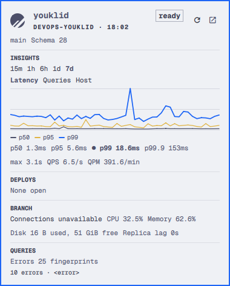

# PlanetScale

PlanetScale status for the [Omarchy](https://omarchy.org) bar. Click the logo, or a metric pinned beside it, to open the panel.



The panel shows database state, open deploy requests, branch metrics, and query errors. Latency, query rate, CPU, memory, and replica lag are averages over `15m`, `1h`, `6h`, `1d`, or `7d`, so one busy minute does not move the numbers. The same range draws a chart with tabs for latency (p50, p95, p99), queries per second, and CPU with memory. Hover a point to read that sample. The open bucket is left out of both the averages and the lines.

Right-click opens the database in the browser. Middle-click refreshes. In the panel, `r` refreshes, `o` opens the browser, and `Esc` closes it.

Click any number in the panel to pin it beside the logo. Click it again to unpin it. Two numbers at most. A third pin replaces the older one. The choice is saved as `barMetrics` in `shell.json`. An older `barMetric` value is still read until you change the pins. The range is saved as `metricPeriod`.

## Install

```bash
omarchy plugin add https://github.com/LukasCaha/omarchy-planetscale --enable
```

The plugin id is `lukascaha.planetscale`. It starts on the right side of the bar. Move it with:

```bash
omarchy bar move lukascaha.planetscale --section right
```

## Configure

Set your database on that entry in `~/.config/omarchy/shell.json`:

```json
{
  "id": "lukascaha.planetscale",
  "organization": "your-org",
  "database": "your-database",
  "branch": "main",
  "refreshIntervalSec": 60,
  "barMetrics": ["p99", "qps"],
  "metricPeriod": "1h"
}
```

`organization` and `database` are the slugs from the PlanetScale URL. `branch` defaults to `main`.

## Service token

Create a PlanetScale service token with `read_database`, `read_branch`, and `read_deploy_request`.

Save it as one line, `TOKEN_ID:TOKEN`, in `~/.config/planetscale/bar-token`, then run `chmod 600` on that file. If the file is missing, or PlanetScale refuses it, the panel asks you to paste the token and saves it there with mode 600. The token is not stored in this repository. `PS_PLUGIN_TOKEN_FILE` overrides the path.

## Remove

```bash
omarchy plugin remove lukascaha.planetscale
```

Removing the plugin leaves `~/.config/planetscale/bar-token` in place. Delete that file yourself if you want the token gone.

## Development

```bash
python3 test_fetch.py
omarchy plugin validate .
```
